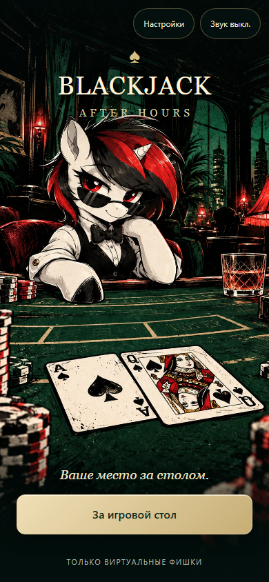
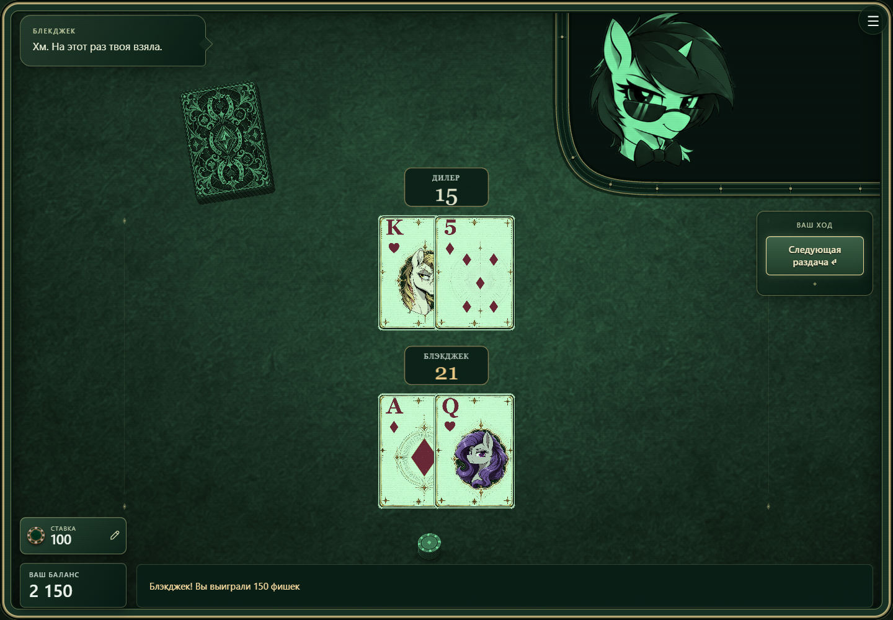

# Blackjack · After Hours

Атмосферный блэкджек с анимированным дилером Блекджек, иллюстрированной колодой и зелёным CRT-экраном. Играйте в браузере или собирайте Android-приложение. Только виртуальные фишки — без регистрации, платежей и сервера.

<p>Версия 1.0.0 · TypeScript · PixiJS 8 · Web и Android</p>

Новая история проекта начинается с текущего состояния версии 1.0.0. Исходники и готовые сборки хранятся в приватном репозитории gaiebboby-ui/Blackjack-After-Hours.

## За игровым столом

- Шесть колод, мягкие тузы, проверка блэкджека дилера до действий игрока (US peek), дилер останавливается на soft 17. Блэкджек оплачивается 3:2, обычная победа — 1:1.
- Добор, остановка, удвоение и разделение одинаковых рангов до трёх рук. Разделённые тузы получают одну карту; повторного разделения тузов, страховки и surrender нет.
- Ставки от 10 до 500 с шагом 10, история результатов и растущие стопки фишек.
- Анимированная раздача, просмотр своих карт, реакции и реплики дилера.
- Адаптивный стол, управление мышью, касанием и клавиатурой. Настройки масштаба карт, быстрых раздач, движения, звука и CRT-эффекта.
- Баланс и настройки сохраняются на устройстве. Звуки синтезируются локально; по умолчанию звук выключен.

Звуки стола обновлены: бумажный шелест карт, мягкий стук фишек и короткое
созвучие победы. Три отдельных музыкальных MIDI-демо с аудиоверсиями,
таймкодами и инструкцией генерации описаны в [заметках о звуке](audio-demos.md).

Перезагрузка во время раздачи возвращает последний баланс завершённого раунда. Это локальная игра: сохранения не защищены от изменения.

## Оформление 1.0.0

Новая иконка Блекджек и стартовый экран в стиле ночного казино. Иллюстрация включена в приложение и работает без интернета.




## Скриншот игры



## Быстрый старт

Понадобится **Node.js 22.12+** и npm.

```sh
npm ci
npm run dev
```

Откройте `http://127.0.0.1:5173/`. В Windows можно запустить [Start-Blackjack.cmd](../Start-Blackjack.cmd), который установит зависимости при первом запуске. Сервер должен оставаться открытым; остановка — `Ctrl+C`.

## Проверка и сборка

```sh
npm test
npm run build
npm run preview
```

Сборка проверяет TypeScript и создаёт `dist/`. Автоматические тесты охватывают правила и выплаты, разделение рук, анимацию дилера, фишки, просмотр карт и расчёт раскладки. GitHub Actions выполняет тесты и сборку при push и pull request.

## Публикация браузерной версии

1. Выполните `npm ci`, `npm test`, `npm run build`.
2. Загрузите **содержимое `dist/`** на статический HTTP(S)-хостинг.
3. Откройте сайт и проверьте загрузку стола, раздачу, настройки и сохранение баланса.

Команда сборки для хостинга: `npm run build`; выходная директория: `dist`. Базовый путь относительный, поэтому сборку можно размещать в подпапке. Не открывайте `dist/index.html` через `file://`: нужен веб-сервер. Сервер приложения, база данных и переменные окружения не требуются. Обложка README не включается в игровой пакет.

Текущий APK и результаты подготовки: [версия 1.0.0](RELEASE-1.0.0.md). Общий порядок упаковки веб-версии: [публикация](RELEASE.md).

## GitHub Pages и автоматические обновления

Проект подготовлен к размещению на GitHub Pages. Публикация стабильного GitHub Release с тегом `v1.0.0` запускает тесты, сборку и обновление сайта. Версия в меню игры берётся из тега; черновики и предварительные релизы не публикуются. Есть ручной запуск по тегу для отката.

Однократная настройка Pages, разрешения окружения для тегов и порядок релиза: [инструкция GitHub Pages](GITHUB_PAGES.md). Исходники размещены в приватном репозитории [gaiebboby-ui/Blackjack-After-Hours](https://github.com/gaiebboby-ui/Blackjack-After-Hours). APK доступен в [релизах](https://github.com/gaiebboby-ui/Blackjack-After-Hours/releases). Pages для приватного репозитория отключён по умолчанию.

## Android

Оболочка использует WebView и включает игру внутрь APK. Работает без интернета; Android 8.0+ и современный Android System WebView обязательны.

Для сборки нужны JDK 17+, Android SDK Platform 36 и Build Tools 36, а также Node.js. На Windows:

```powershell
.\Build-Android.ps1 -WithTests
```

Результат: `artifacts/Blackjack-After-Hours-1.0.0.apk`. Ключ `-WithTests` дополнительно **собирает** тестовый APK; для запуска тестов требуется подключённое устройство или эмулятор и `connectedDebugAndroidTest`.

Это отладочный APK. Публикация в магазине требует отдельной release-сборки, собственного ключа подписи и проверки требований магазина. Ключи и локальные настройки SDK исключены из Git. Подробнее: [Android: устройство оболочки и проверки](ANDROID.md).

## Структура проекта

- `src/` — правила игры, PixiJS-сцена, DOM-интерфейс, настройки и анимация.
- `tests/` — автоматические проверки.
- `assets/cards/` — 52 карты, выбранные портреты и генератор колоды.
- `assets/dealer/` — актуальные кадры, слои лица и исходники дилера.
- `assets/scene/`, `assets/sprites/` — стол и фишки, мастер-файлы и игровые экспорты.
- `public/` — иконки приложения; `public/game/` создаётся автоматически.
- `scripts/prepare-assets.mjs` — подготовка игровых ресурсов перед запуском и сборкой.
- `android/` — Android-оболочка и её тесты.
- `doc/` — документация, решения по архитектуре и медиа для README.
- `_archive/` — локальный архив старых материалов с `manifest.json`; исключён из Git и не нужен для сборки.

`node_modules/`, `dist/`, `artifacts/`, кэши и сгенерированные Android-ресурсы также не хранятся в репозитории. Не используйте `git add -f` для архива или ключей подписи.

## Работа с графикой

Текущая колода уже экспортирована: Python для запуска и сборки игры не нужен. Для изменения карт установите Pillow; текущий генератор использует системные шрифты Windows (Georgia и Segoe UI Symbol). Выполните:

```sh
python assets/cards/build_deck.py
npm run assets
```

Оформление Retro Casino собирается из пяти растровых слоёв в `assets/cards/layers/` с помощью `retro_style.py`. Портреты фигурных карт выбираются в `COURT_CAST` внутри генератора. Размер исходной карты — 512×716. Дополнительные атласы и превью генерируются для работы с графикой и исключены из Git.

Текущие файлы `assets/dealer/v3/frame-*.png` и `face-*.png` — готовые игровые ресурсы. [Порядок восстановления графики дилера](ASSETS.md) описывает исходный лист и отдельную правку усмешки. После изменения ресурсов пересоберите игру.

Проверка происхождения изображений, архив и список недостающего: [изображения проекта](ARTWORK.md). Сборка автоматически проверяет разрешённые файлы.

## Лицензия

Код проекта распространяется по GNU General Public License версии 3 (SPDX: `GPL-3.0-only`). Полный текст приведён в [LICENSE](../LICENSE).

Проект использует персонажей сторонних произведений. Лицензия на код не предоставляет прав на сторонних персонажей, торговые обозначения, референсы и иллюстрации. Условия использования сторонних материалов и зависимостей определяются их правообладателями; сведения об изображениях приведены в [документации](ARTWORK.md).
